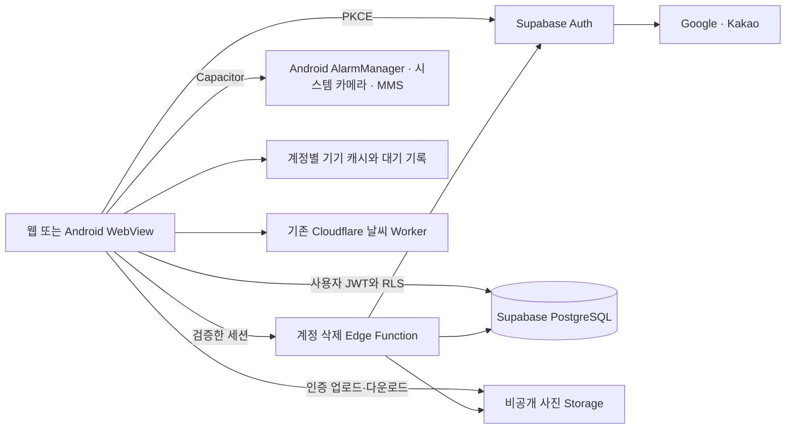
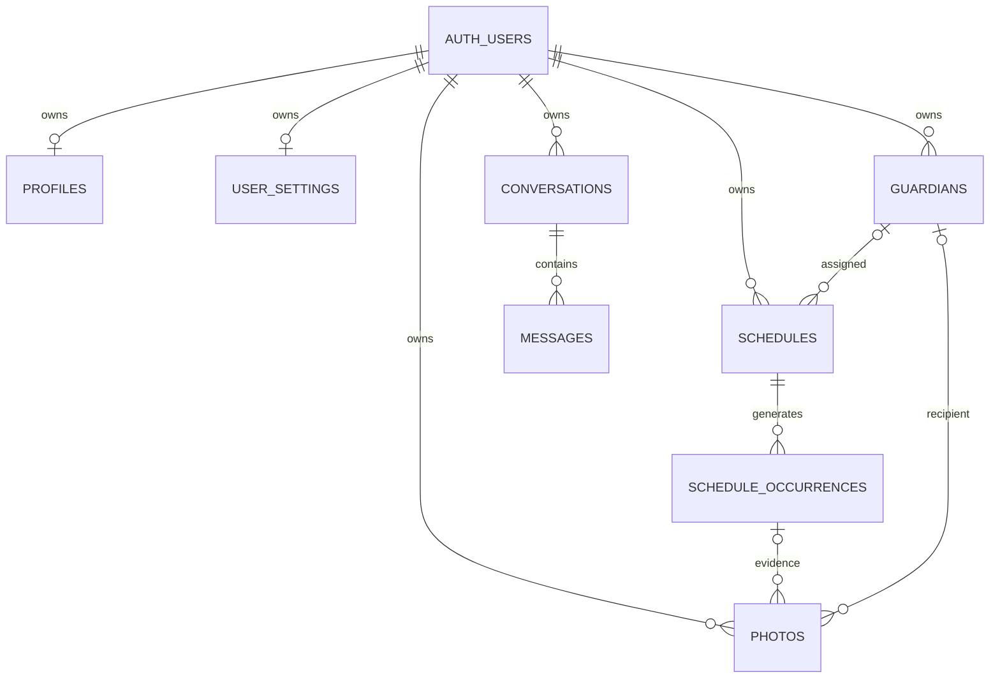

# 계정과 데이터 구조

| 테이블 | 내용 |
| --- | --- |
| `profiles`, `user_settings` | 표시 이름, 별도 호칭, 캐릭터, 말벗 답변 합성 음성 설정, 첫 프로필 설정 완료 시각 |
| `schedules` | 서울 시간대의 시각, 날짜·범위·요일 반복 규칙, 기존 알림 방식과 사전 알림, 복약 메모 |
| `schedule_occurrences` | 같은 일정·서울 날짜에 한 행. 실행 시각, 완료 여부, 확인 시각과 단순 확인·사진 인증 구분 |
| `guardians` | 사용자가 고른 이름과 전화번호 |
| `conversations`, `messages` | 캐릭터별 세션 및 최종 발화와 답변. 세션, 대화 턴, 역할을 사용해 재시도 중복 방지 |
| `photos` | 촬영 시각, 대응하는 일정 실행 시각, 업로드 시각, 비공개 객체 키, 사진 크기, 첨부 작성 성공·실패 |

모든 앱 테이블은 인증된 사용자와 `user_id`가 일치할 때만 접근할 수 있다. 복합 외래키는 연결하는 객체의 소유자도 같아야 한다. Storage RLS에는 버킷, UUID 경로, 객체 소유자 검사가 있다. `verification-photos/{user_id}/{year}/{month}/{photo_id}.jpg`의 년월은 촬영 시각의 서울 날짜다. 사진은 인증된 다운로드를 사용하며 앱에서 표시하는 임시 객체 URL은 정리한다. 메시지 상태는 Android 작성 화면을 연 사실만 기록한다.

Supabase는 현재 계정 자료의 원본이다. 일정 등록·수정·삭제와 보호자·설정 변경은 서버 성공 후 앱에 적용한다. 일정 수정·삭제에는 마지막 서버 수정 시각을 사용하여 다른 기기의 변경을 덮어쓰지 않도록 한다. 기존 AsyncStorage 일정 키 `weather-schedule:schedules:v1`과 보호자·사진 키 `allit:android-care:v1`은 원본 기기 데모 및 명시적인 자료 가져오기에 보존한다. 회원 정보 입력은 통합 Expo 앱에 저장된 기존 온보딩이 없음을 확인한 뒤 첫 로그인에 이름과 호칭만 선택적으로 연결했다. 통합 전 HTML 프로토타입의 생년월일 입력은 새 수집 항목에 포함하지 않았다.

로그인 후 같은 WebView origin에서 기기 자료를 발견하면 가져오기를 제안한다. 동의하면 일정·완료 기록·보호자와 Android에 남아 있는 확정 사진을 복사한다. 사진은 현재 계정 전용 경로로 최적화 복사한 뒤 업로드 대기열에 추가한다. 원본은 유지하며 파일을 찾을 수 없는 경우 그 수를 안내한다. 계정 UUID와 원본 ID로 같은 가져오기 키를 만들어 재시도 중복을 막는다. 진단용 사진과 이미 사라진 파일, 다른 origin이나 다른 앱의 저장소는 이전하지 않는다.

로그인 계정 UUID로 구분한 IndexedDB는 마지막으로 읽은 일정·사진 메타데이터와 완료·사진·대화 대기열을 저장한다. 온라인 복귀, Android 복귀, 앱 재실행과 설정에서의 수동 재시도가 큐를 확인한다. 일반 일정 변경은 네트워크가 필요하며, 이미 등록된 일정의 완료 및 사진 인증은 연결 없이 기록할 수 있다. Android 예약을 서버 조회에 연결하되 AlarmManager가 로컬 예약을 실행하므로 웹·네트워크를 쓰지 않고도 정각에 알람이 울린다. 네이티브 예약 실패 시 기존 오류 안내와 재동기화 흐름을 사용한다.

사진 확정 전에 버린 촬영 파일은 업로드하지 않는다. 확정 사진을 앱 전용 파일로 보존하고 업로드한다. 업로드와 메타데이터는 같은 사진 UUID를 사용한다. 바이너리만 먼저 저장됐다면 다음 시도에서 객체의 크기를 확인하고 메타데이터 저장을 재개한다. 이미지를 갖고 있는 Android 메시지 작성은 업로드를 기다리지 않는다. 서버에서 다시 내려받은 사진도 계정 전용 파일에 보관해 FileProvider로 공유할 수 있다. 앱에서 발신 여부를 추정하지 않는다.

로그아웃하면 해당 계정의 네이티브 예약·로컬 계정 캐시·계정 사진을 정리한다. 미동기화 자료가 있으면 안내하고 같은 계정에서 동기화를 완료할 수 있게 한다. 이전 계정에 속한 대기열은 다른 계정으로 전송하지 않는다. 일정 예약, 확인 기록과 사진 작업의 Android 호출은 현재 계정 UUID를 다시 검사해 계정 변경 전에 시작한 요청이 새 계정에 적용되는 일을 막는다. 회원 탈퇴는 토큰을 검증하고 대기 마커로 추가 쓰기를 차단한 다음, Storage API로 파일을 배치 삭제하고 Auth 사용자를 삭제한다. DB는 외래키 연쇄 삭제로 정리되고 해당 기기의 세션과 로컬 자료를 지운다. 다른 기기의 오프라인 알람은 그 기기가 다시 연결되어 계정 삭제를 확인할 때 정리된다. 기기 밖의 이미 전송된 메시지는 수신자의 메시지 앱에 남을 수 있다.

출시 빌드는 개발용 dotenv를 읽지 않는다. 독립 웹의 출시용 IndexedDB는 Supabase 호스트별로 분리하며 출시에서는 개발용 기기 자료의 가져오기 화면을 표시하지 않는다. `202611270003_ai_foundation.sql`은 `extensions.vector`와 비공개 `allit_ai.documents`, `allit_ai.chunks`를 설치한다. Auth 사용자와 복합 소유자 외래키를 연결해 계정 삭제 시 미래의 AI 데이터도 함께 정리한다. 이 스키마는 서비스 역할만 사용한다. 현재 앱은 자료를 넣거나 검색하지 않는다.
